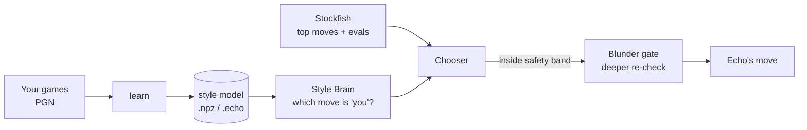

# echostar

[](https://github.com/nomadx3dg/echostar/actions/workflows/ci.yml)

**Echo is a chess engine that learns how *you* play, then plays your style while staying correct.**

- It reads your games and builds a model of your habits: openings, trades vs. tension, pawn storms, king safety, early queen moves, and so on.
- Stockfish keeps it honest: Echo only chooses among moves that are nearly as good as the best one, and re-checks its pick with a deeper search before playing it.
- One dial controls the trade-off between "very much you" and "near-perfect".

> Status: working prototype in Python, with a Rust port. The idea is only proven on synthetic data so far; see [Honest limits](#honest-limits) and [ROADMAP.md](ROADMAP.md).

## How it works



1. **Style Brain.** A small neural net plus 21 readable style features, trained to predict *your* move in a position.
2. **Truth Engine.** Stockfish analyses the position and returns its top 8 moves with evaluations.
3. **Chooser.** Keeps only moves within the safety band of the best move, picks the one the Style Brain likes most, and sends it through the blunder gate.

The band tightens automatically in decided positions, and a forced mate is always taken.

## Quick start

```bash
pip install -r requirements.txt            # python-chess, numpy
# also install Stockfish (apt install stockfish / brew install stockfish / pkg install stockfish)

python echo.py fetch YourLichessName --max 500 --out games.pgn
python echo.py learn games.pgn --player YourLichessName --out style.npz
python echo.py profile style.npz
python echo.py play --style style.npz --dial balanced --show
```

### Termux (Android)
```bash
pkg install python python-numpy stockfish rust git
pip install python-chess
```
If `pip install numpy` fails on your phone, use `pkg install python-numpy` as above.

## Get your games

`fetch` uses the public Lichess and Chess.com APIs (no login or token needed for public games):

```bash
python echo.py fetch YourName                                  # Lichess, newest 500 games
python echo.py fetch YourName --speed blitz,rapid --rated      # Lichess filters (--rated is Lichess only)
python echo.py fetch YourName --site chesscom --max 300 --speed blitz,rapid
```

Or export a PGN by hand (Lichess: profile, Export games; Chess.com: Settings, Download). `--player` must match your
name in the PGN `[White]`/`[Black]` lines; capitalization doesn't matter.

## Train and inspect

```bash
python echo.py learn games.pgn --player YourName --out style.npz
python echo.py profile style.npz --export profile.md
```

`learn` holds out 10% of your games and reports how often the model predicts your exact move on games it never trained on,
next to what random guessing would score. `profile` then shows something like this (example from synthetic data):

```
Style profile for Me (60 games, 2100 positions)

  + moves_knight             you  42.2%  vs random  17.9%
  - quiet_move               you  73.0%  vs random  88.1%
  + capture                  you  23.9%  vs random   9.0%

  Opening book: 210 positions from your games
    As White, first move: e4 (31x), d4 (12x)

  Accuracy on games it never trained on:
    predicts your exact move 11.9% of the time (random guessing: 4.1%)
```

Useful options:

| Option | Meaning |
|---|---|
| `--speed blitz,rapid` | train only on these speeds (bullet, blitz, rapid, classical) |
| `--min-opp-rating 1500` | train only on games against opponents at least this rated |
| `--resume style.npz` | keep training an existing model with new games |
| `--epochs N`, `--lr X` | training length and step size |

Chess variants (Chess960, Crazyhouse, ...) are skipped automatically. Use 60+ games for a meaningful profile, 300+ for a good one.

## Play

```bash
python echo.py play --style style.npz --dial balanced --color white --show
```

| Dial | Safety band | Behavior |
|---|---|---|
| `faithful` | 120 cp | plays most like you, accepts small inaccuracies |
| `balanced` | 50 cp | your style with fewer slips |
| `sharp` | 20 cp | near-perfect play, style as the tiebreaker |

In a game, type moves like `e4`, `Nf3`, `O-O`, `e8=Q` (or `e2e4`). Other commands: `undo`, `hint`, `resign`, `help`, `quit`.

Other options: `--movetime SECONDS` (instead of `--depth`), `--band CP` and `--temp X` (custom dial), `--seed N`
(reproducible games), `--threads`, `--hash`, `--plain` (ASCII board), `--no-save`.
`--show` turns on coach mode: it prints how many moves were safe, the engine's best move, Echo's pick, and an end-of-game
summary of how much strength Echo traded for style.

### Learning loop
Every game you play is saved to `games/` as a PGN. Feed them back in:

```bash
python echo.py learn games/*.pgn --player YourName --resume style.npz --out style.npz
```
(concatenate several files first if your shell can't expand the glob into one input.)

## Rust engine and UCI mode

`rust/` is a faster, dependency-light port of the engine. Training stays in Python; Rust only runs the trained model, and is
checked against Python with golden test vectors.

```bash
python echo.py export style.npz --out style.echo
cd rust && cargo build --release
./target/release/echo-rs play --style ../style.echo --dial balanced --movetime 1
./target/release/echo-rs profile ../style.echo
./target/release/echo-rs uci --style ../style.echo       # run as a UCI engine
```

`echo-rs uci` lets chess GUIs and [`lichess-bot`](https://github.com/lichess-bot-devs/lichess-bot) use Echo as an engine.
UCI options: `StylePath`, `StockfishPath`, `Dial`, `Band`, `Depth`, `Threads`, `Hash`.

## Project layout

```
echo.py                 Python prototype and trainer (learn, profile, fetch, play, export)
rust/                   Rust port: model, features, Stockfish client, chooser, terminal play, UCI mode
tests/                  Python tests (chooser tests use a fake engine, so Stockfish isn't required)
tools/make_golden.py    regenerates the Rust/Python parity vectors
docs/                   ARCHITECTURE.md, FORMAT.md (the .echo model file)
ROADMAP.md              milestones, including the Lichess bot plan
```

## Tests

```bash
pip install -r requirements-dev.txt
make test                # Python and Rust
```
Or run them separately: `python -m pytest` and `cargo test --manifest-path rust/Cargo.toml`.
`make lint` runs clippy on the Rust code, the same check CI uses.

## Honest limits

- **Not proven on real players yet.** All testing so far used synthetic games with a planted style. Roadmap milestone M2 is the real test.
- **Few games means memorizing.** Under about 2,000 positions (roughly 60 games) the net mostly memorizes; the held-out accuracy line tells you how much to trust it.
- **Style costs strength.** A wider safety band is more "you" and less perfect. That's the dial.
- **Stockfish is required** at play time. A self-contained lightweight engine is a later milestone.
- **Not for cheating.** Don't use Echo to pick moves in your own live games on Lichess or Chess.com. As a separate opponent or bot it's fine.

## FAQ

**`No games found for player 'X'`** The name must match the PGN headers. Check with `grep -m1 '^\[White' games.pgn`.

**`Stockfish not found`** Install it, or pass `--stockfish /path/to/stockfish`.

**`cat style.npz` prints garbage.** It's a compressed binary file. Use `python echo.py profile style.npz`, or add `--export profile.md` for a readable summary.

**The board looks garbled.** Use `--plain` for an ASCII board.

**Echo is too passive or too sharp.** Change `--dial`, or set `--band` directly (centipawns Echo may give up per move).

## More

- [ROADMAP.md](ROADMAP.md): milestones, including the Lichess bot
- [docs/ARCHITECTURE.md](docs/ARCHITECTURE.md): design notes
- [docs/FORMAT.md](docs/FORMAT.md): the `.echo` model format

License: not chosen yet. (Note that Stockfish is GPL; if you ship its binary together with Echo, pick a compatible license.)
